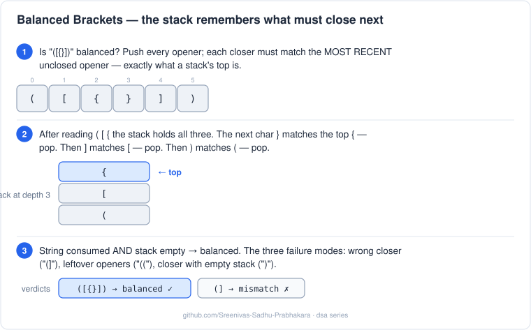

# Check Balanced Parentheses

> Striver SDE Sheet 079 · Day 13 Stack & Queue — a stack of open brackets; each closer must match the top, and the end must find it empty. Go, stdlib only, tested.

## Problem

Decide whether a string's brackets — `()`, `[]`, `{}` — are balanced: every closer matches the most recent unclosed opener, nothing closes what isn't open, nothing stays open.

## Approach

The stack *is* the definition of balance: push openers; a closer must find its partner on top (pop) or the string is invalid. Three distinct failure modes, and each maps to one line of the check: a closer with an empty stack (`)...`), a closer over the wrong top (`([)]`), and leftovers at the end (`(((`). The map from closer to opener keeps the three bracket kinds in one code path. This is the canonical "first stack problem" because expression parsing, interleaved scopes and HTML tag matching are all this check wearing different clothes.

**Complexity:** O(n) time, O(n) worst-case stack.

## Visual walkthrough

Read the picture top to bottom — each numbered frame is one moment of the algorithm
running on this repo's test example.

## Run

    go test ./...   # verify
    go run .        # demo

---

One of 191 repos solving Striver's SDE Sheet in Go — stdlib only, one problem per repo, every solution tested. Browse the set: [`dsa-*` repos](https://github.com/Sreenivas-Sadhu-Prabhakara?tab=repositories&q=dsa-&type=source).
